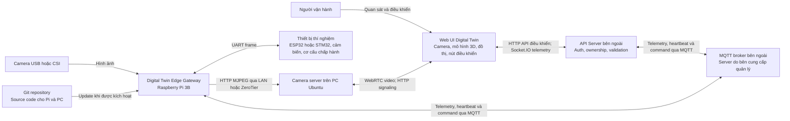

# C4 Level 1 — System Context

## Mục tiêu và phạm vi

**Trạng thái: đã chốt thiết kế.** Digital Twin Edge Gateway chạy trên Raspberry Pi 3B, kết nối thiết bị thí nghiệm vật lý với Web UI. Hệ thống cung cấp telemetry, chuyển tiếp command và cung cấp camera stream.

Phạm vi thiết kế repo gồm application và configuration trên Pi, cùng camera server trên PC Ubuntu. Kiến trúc camera Pi → PC đã có source và kiểm thử giả lập hai camera; cần xác minh trên hardware. MQTT broker trên server bên ngoài, Web UI, MCU firmware và cơ cấu thí nghiệm là các hệ thống hoặc thiết bị ngoài phạm vi repo.

## Đối tượng tương tác

| Đối tượng | Tương tác |
| --- | --- |
| Người vận hành | Xem camera stream, telemetry, mô hình 3D và gửi lệnh điều khiển từ Web |
| Người bảo trì | Cấu hình Pi, kiểm tra service và kích hoạt update |
| Web UI | Nhận telemetry qua Socket.IO, gửi command qua HTTP API; thiết lập WebRTC và nhận video từ camera server trên PC |
| API Server | Xác thực sinh viên, quản lý lượt thực hành, publish command và nhận telemetry/heartbeat qua broker |
| MQTT broker bên ngoài | Phân phối telemetry, heartbeat và command giữa Pi và API Server theo quy chuẩn topic của kit |
| MCU | Đọc cảm biến, điều khiển cơ cấu và trao đổi UART frame với Pi |
| Camera | Cấp MJPEG cho Pi thu hình |
| Camera server trên PC | Nhận MJPEG từ Pi, mã hóa VP8 bằng aiortc và phục vụ WebRTC |
| Git repository | Lưu source code và version để Pi thực hiện update |

MCU giao tiếp với Pi qua UART; Pi và API Server trao đổi telemetry, heartbeat và command qua broker MQTT bên ngoài. Web UI không kết nối trực tiếp broker mà tương tác qua API Server (FR-DEV-004). Pi đóng vai trò gateway chuyển tiếp command từ MQTT xuống MCU và publish telemetry từ cảm biến lên MQTT theo tần suất quy chuẩn. Camera có hai đoạn: Pi phục vụ HTTP MJPEG để PC nhận hình; PC mã hóa VP8 bằng aiortc và phục vụ WebRTC cho Web, dùng HTTP signaling. LAN hoặc ZeroTier cung cấp đường mạng Pi ↔ PC; SSH chỉ để quản trị. Các yêu cầu real-time của điều khiển cơ cấu và xử lý lỗi tại thiết bị cần được xác định ở phía firmware.

## Giới hạn hiện tại

Chưa thiết kế cơ chế đồng bộ mô hình 3D phía Web, logic điều khiển chi tiết của firmware hoặc yêu cầu an toàn của từng cơ cấu. Flash firmware ESP32 từ Pi là tính năng dự kiến, chưa thuộc triển khai ban đầu.
