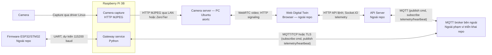

# C4 Level 2 — Containers

**Trạng thái: đã chốt thiết kế.** Thiết kế mới: Pi chạy gateway và nguồn camera MJPEG; PC Ubuntu chạy camera server aiortc. Phần camera tách Pi/PC đã có source và kiểm thử giả lập; chưa benchmark hardware. MQTT broker chạy trên server bên ngoài; chưa xác nhận loại broker đang sử dụng. Task UART và MQTT bridge được triển khai trong cùng gateway service.

## Trách nhiệm

| Service | Trách nhiệm | Interface |
| --- | --- | --- |
| Gateway | Kết nối UART, kiểm tra frame, chuyển đổi telemetry/heartbeat và command | UART với MCU; MQTT với broker |
| Camera capture trên Pi | Lấy MJPEG nén sẵn từ USB, chuyển tiếp JPEG | V4L2; HTTP MJPEG cho PC |
| Camera server trên PC | Nhận/giải mã JPEG, mã hóa VP8 và quản lý browser peer | HTTP ingest từ Pi; HTTP signaling và WebRTC với browser |

Gateway là process duy nhất của application mở UART port. Camera không phụ thuộc gateway để stream video. Broker bên ngoài phân phối message theo topic; repo chỉ quản lý phần kết nối client trên Pi.

## Data flow

1. **Telemetry:** cảm biến → MCU → UART → gateway validate và decode frame → MQTT publish (`lab/kit/{kit_code}/telemetry`, 2 Hz) → broker bên ngoài → API Server → Socket.IO tới Web UI của sinh viên sở hữu lượt.
2. **Command:** Web UI → HTTP API (kiểm tra ownership, active attempt, validation) → API Server publish MQTT (`lab/kit/{kit_code}/cmd/...`) → broker bên ngoài → gateway subscribe và validate command → encode UART frame → MCU → cơ cấu chấp hành.
3. **Heartbeat:** Gateway publish (`lab/kit/{kit_code}/heartbeat`) khi kit đang in-use để duy trì watchdog 30 giây phía Server.
4. **Video:** camera → Pi thu JPEG → HTTP MJPEG → PC giải mã/mã hóa VP8 → WebRTC → Web UI. Browser và PC trao đổi SDP qua HTTP signaling.

Video không đi qua MQTT. Hệ thống không sử dụng cơ chế command acknowledgment riêng cho lệnh sinh viên. Web UI và Server xác nhận trạng thái thực tế dựa trên bản tin telemetry 2 Hz do kit gửi lên; UI giữ số đo/trạng thái cũ cho đến khi nhận được telemetry mới.

## Quyết định và điểm chưa chốt

- **Đã chốt:** service được quản lý bằng systemd; không yêu cầu Docker trong phase hiện tại.
- **Đã chốt:** UART frame có Header, Length, Payload và Checksum/CRC.
- **Đã chốt kiến trúc MQTT:** Web UI không kết nối trực tiếp broker; mọi lệnh qua API Server. Giao tiếp Pi ↔ Server qua MQTT phân định theo topic `lab/kit/{kit_code}/...`.
- **Đã chốt danh mục topic:**
  - `lab/kit/{kit_code}/telemetry` (Pi → Server, 2 Hz khi thực hành).
  - `lab/kit/{kit_code}/heartbeat` (Pi → Server, chỉ khi in-use).
  - `lab/kit/{kit_code}/cmd/reset` (`start`, `stop`, `calib`).
  - `lab/kit/{kit_code}/cmd/power` (`on`, `off` nguồn AC trong lượt).
  - `lab/kit/{kit_code}/cmd/voltage` (mức 0, 3, 6, 9, 12 V).
  - `lab/kit/{kit_code}/cmd/scale` (thang Tesla `"1.999"`, `"19.99"`, `"199.9"` mT).
  - `lab/kit/{kit_code}/cmd/ruler` (vị trí tuyệt đối 0–300 mm).
  - `lab/kit/{kit_code}/cmd/shutdown` (tắt toàn bộ kit theo yêu cầu admin).
- **Đã chốt nguyên tắc dữ liệu:** Không có khóa K; dòng điện đo gửi bằng mA (`current_ma`); từ trường đo gửi bằng mT (`magnetic_field`, 0–200, không âm); không tự clamp.
- **Đã chốt camera:** Pi phục vụ HTTP MJPEG, PC chủ động nhận hình và chạy aiortc/WebRTC. HTTP `POST /offer` nằm trên PC; demo LAN không trickle ICE, STUN hoặc TURN.
- **Profile đầu:** một camera 640×480 @ 15 FPS, một browser, benchmark LAN trước rồi ZeroTier.
- **Mở rộng:** 30 FPS, nhiều browser và hai camera phải benchmark trên PC; nguồn USB và băng thông Pi vẫn cần đo.
- **Trạng thái:** source Pi/PC đã triển khai, hardware chưa benchmark; xem [camera integration](04-camera-webrtc.md).
- **Chưa chốt cho production:** codec tối ưu, authentication, TLS, STUN/TURN, giới hạn peer và chính sách reconnect.
- **Chưa chốt:** cấu hình UART frame cụ thể với MCU (header, CRC parameters), adapter tắt nguồn vật lý cho shutdown, endpoint broker chính thức và credential triển khai.
- **Dự kiến:** flash firmware từ xa khi có nhu cầu và đủ điều kiện vận hành.
