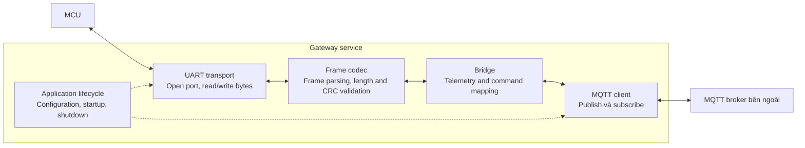

# C4 Level 3 — Components

Các component dưới đây mô tả trách nhiệm bên trong service. Khi triển khai, mỗi component có thể tương ứng với một hoặc nhiều module trong `src/`.

## Gateway service

UART transport quản lý serial connection và đọc/ghi byte. Frame codec parse byte stream, validate frame và encode frame gửi đi. Codec phải xử lý cả frame bị chia qua nhiều lần read và nhiều frame trong một lần read. Bridge chuyển đổi UART payload sang MQTT payload và validate command trước khi gửi xuống MCU. MQTT client quản lý connection, publish và subscribe theo topic đã cấu hình. Application lifecycle quản lý configuration, startup và shutdown, đồng thời giải phóng resource khi service dừng.

### UART protocol

**Đã chốt:** mỗi frame gồm `Header | Length | Payload | Checksum/CRC`. Frame không hợp lệ bị loại bỏ trước khi bridge xử lý payload.

**Chưa chốt:** giá trị header, kích thước length field, các byte được tính trong length, byte order, loại checksum/CRC và tham số của nó, vùng byte dùng để tính CRC, giới hạn payload, message type, đơn vị đo, timeout và cơ chế frame resynchronization khi gặp nhiễu. Các thông số này phải được thống nhất với firmware trước khi viết codec.

Chu kỳ telemetry 50 ms và baudrate 115200 là thông số dự kiến. Cần tính frame size và kiểm tra khả năng xử lý thực tế. Serial port phải cấu hình được.

### MQTT protocol

**Đã chốt kiến trúc:** Web UI không kết nối trực tiếp MQTT broker (FR-DEV-004); mọi lệnh điều khiển đi qua API Server để kiểm tra xác thực, quyền sở hữu lượt và validation. API Server publish command xuống broker; Gateway trên Pi subscribe command. Chiều ngược lại, Gateway trên Pi publish telemetry và heartbeat lên broker; API Server subscribe và chuyển tiếp về Web UI qua Socket.IO.

Mỗi kit được định danh duy nhất bằng `kit_code` (cấu hình trong gateway). Danh mục topic tuân thủ tiền tố `lab/kit/{kit_code}/...`.

#### 1. Server → Kit (Commands)

| Topic | Payload | Ý nghĩa / Quy tắc |
| --- | --- | --- |
| `lab/kit/{kit_code}/cmd/reset` | `{"action":"start"}` `{"action":"stop"}` `{"action":"calib"}` | **Bắt buộc có `action` (đã chốt); bãi bỏ payload rỗng**. - `start`: Đầu lượt, server gửi khi cấp kit, bắt đầu giám sát. - `stop`: Cuối lượt, đưa thiết bị về trạng thái an toàn. - `calib`: Sinh viên hiệu chuẩn cảm biến trong lượt. |
| `lab/kit/{kit_code}/cmd/power` | `{"action":"on"}` `{"action":"off"}` | **ON/OFF nguồn AC trong lượt (đã chốt)**. Nút nguồn AC ống dây, **không phải shutdown kit**, không kết thúc lượt. |
| `lab/kit/{kit_code}/cmd/voltage` | `{"voltage": <mức>}` | **Chọn mức điện áp nguồn AC (đã chốt)**. Chỉ nhận các mức: `0, 3, 6, 9, 12` (V). |
| `lab/kit/{kit_code}/cmd/scale` | `{"scale": "<thang>"}` | **Chọn thang Tesla Meter**. Chuỗi enum: `"1.999"`, `"19.99"`, `"199.9"` (mT). Không dùng float. |
| `lab/kit/{kit_code}/cmd/ruler` | `{"position": <vị trí>}` | **Vị trí tuyệt đối thước**. Số nguyên `0–300` (mm), bước 1 mm. Không dùng delta. |
| `lab/kit/{kit_code}/cmd/shutdown` | `{"action":"shutdown"}` | **Tắt toàn bộ nguồn kit từ admin**. Topic riêng biệt với OFF nguồn AC và reset. Dừng MQTT và camera. |

*Lưu ý: Không còn khóa K trong hệ thống; không có topic command cho K.*

#### 2. Kit → Server (Telemetry & Heartbeat)

| Topic | Tần suất | Payload & Quy tắc |
| --- | --- | --- |
| `lab/kit/{kit_code}/telemetry` | **2 Hz** khi thực hành | Bộ thông số thực tế từ cảm biến. - `magnetic_field`: 0–200 mT, không âm, giữ số gốc độ chính xác cao, không clamp. - `current_ma`: Dòng điện đo thực tế bằng **mA** (không đổi sang A). - `voltage`: Điện áp đo thực tế (V), độc lập mức đặt. - `power_on`: Boolean trạng thái nguồn AC. - `scale`: Thang hiện tại (`"1.999"`, `"19.99"`, `"199.9"`). - `ruler_position`: Vị trí thước hiện tại (0–300 mm). - Không có trường khóa K; không phát khi bảo trì/inactive. |
| `lab/kit/{kit_code}/heartbeat` | Định kỳ (draft) | Tín hiệu sống duy trì watchdog 30s của server. - **Chỉ gửi khi kit `in-use`** (đang trong lượt thực hành). - Khi kit `idle` hoặc đang nghỉ: **không yêu cầu heartbeat**; server không coi im lặng ngoài lượt là kit lỗi. |

#### 3. Quy ước Delivery và Acknowledgment

- **Retain:** `retain=false` cho toàn bộ command, telemetry và heartbeat.
- **QoS:** Đề xuất QoS 0 cho telemetry và heartbeat; QoS 1 cho command.
- **Acknowledgment:** Hệ thống **không sử dụng MQTT command acknowledgment riêng** cho lệnh sinh viên. Web UI và Server xác nhận kết quả lệnh thông qua bản tin telemetry 2 Hz do kit gửi về; UI giữ trạng thái cũ đến khi telemetry mới xác nhận.
- **Fencing:** Lệnh cũ của lượt trước không được tác động lượt mới hoặc phát lại sau reboot. Lệnh shutdown cũ không được phát lại làm tắt kit sau reboot.

## Camera capture trên Pi và camera server trên PC

**Đã triển khai source và kiểm thử giả lập hai camera.** Pi dùng FFmpeg V4L2 MJPEG stream copy; PC nhận HTTP MJPEG, giải mã JPEG bằng OpenCV và chạy aiortc. Chưa benchmark hardware.

```mermaid
flowchart LR
    device["USB camera MJPG"] --> capture["Pi: V4L2 lấy JPEG"]
    capture --> http["Pi: HTTP MJPEG"]
    http -->|"LAN hoặc ZeroTier"| ingest["PC: MJPEG ingest/reconnect"]
    ingest --> decode["PC: giải mã JPEG, latest frame"]
    decode --> track["PC: aiortc video track / VP8"]
    track --> peer["PC: peer lifecycle"]
    peer <-->|"WebRTC media"| web["Browser"]
    web <-->|"HTTP /offer"| signaling["PC: signaling"]
    signaling --> peer
```

Pi thu MJPEG nén sẵn từ camera, giữ JPEG mới nhất và phục vụ HTTP; không giải mã BGR rồi encode JPEG lại, không chạy encoder VP8. Đường capture đã dùng FFmpeg `-c:v copy`; cần xác minh với driver thực tế.

PC dùng một kết nối ingest cho mỗi camera, đọc multipart JPEG, giải mã và giữ frame mới nhất. Ingest cần timeout, phát hiện frame cũ và reconnect có backoff. Timestamp video dựa clock monotonic tại PC; không tích hàng đợi khi encoder chậm.

PC phục vụ demo `GET /`, health và `POST /offer`; browser tạo offer, PC trả answer. Mỗi browser có peer/encoder riêng ở bản đầu. `max_peers` và worker encode là tài nguyên PC; không tự tăng tải encoder Pi theo số người xem. SFU hoặc encode dùng chung chưa triển khai.

Peer cần cleanup khi Stop, rời trang, connection lỗi hoặc hết hạn. Hai camera là hai nguồn ingest và hai track. Pi dùng `capture.yaml`, PC dùng `server.yaml`; mỗi nguồn có URL `/cameras/{id}/video_feed`. Có unit riêng cho Pi capture và PC server. Contract endpoint dự kiến và nghiệm thu nằm tại [04-camera-webrtc.md](04-camera-webrtc.md).

## MQTT broker bên ngoài

Broker chạy trên server bên ngoài, nằm ngoài phạm vi triển khai của repo. Chưa xác nhận phần mềm broker đang sử dụng. Gateway trên Pi đóng vai trò MQTT client kết nối với broker để trao đổi dữ liệu với API Server. Web UI tương tác với API Server qua HTTP API và Socket.IO, không kết nối trực tiếp MQTT broker (FR-DEV-004).

Cần xác nhận hostname, port, TLS, credentials và topic permissions cho Gateway trên Pi trước khi tích hợp. Chi tiết kết nối nằm trong [deployment.md](deployment.md).

## Shared code và logging

`shared/` chứa package `digital-twin-common`, dùng chung cho Python service. Package cung cấp YAML mapping loader và logging initialization; không import code của camera hoặc gateway. Camera schema, capture và HTTP endpoint vẫn nằm trong `services/camera/`.

`config/logging.yaml` quản lý log level, format, date format và output handler. Mỗi service gọi `configure_logging()` một lần tại startup; module dùng `logging.getLogger(__name__)`. Profile hiện tại ghi stdout để systemd thu log qua journald. Có thể cấu hình level theo module bằng section `loggers` trong YAML.

Camera chọn logging file qua `--log-config` hoặc `LOG_CONFIG_FILE`. Logging configuration thiếu hoặc không hợp lệ sẽ làm startup thất bại. Restart service sau khi sửa YAML.
