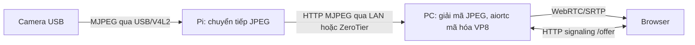

# Camera — Pi thu hình, PC phục vụ WebRTC

## Quyết định và trạng thái

**Đã triển khai source mới, kiểm thử giả lập đạt; hardware chưa benchmark:** Pi 3B thu hình từ camera USB và phục vụ HTTP MJPEG; PC Ubuntu nhận hình, giải mã JPEG và dùng `aiortc` mã hóa VP8, phục vụ WebRTC cho browser.

CLI hiện tại chọn role `capture` hoặc `server`. Pi đọc `capture.yaml` và dùng unit `digital-twin-camera`; PC đọc `server.yaml` và dùng unit `digital-twin-camera-server`. Bản combined cũ chỉ giữ module và `legacy.yaml` cho regression test. Phải cập nhật dependency, YAML và unit khi nâng cấp. Benchmark cũ cho thấy tải VP8 cao và video giật khi hai browser xem trên Pi. Source mới chuyển mã hóa sang PC; kiểm thử xác minh hai nguồn MJPEG tới hai WebRTC track, reconnect và session cleanup, chưa xác nhận hiệu năng hardware.

## Đường đi của hình ảnh

- Camera Ugreen đã xác minh hỗ trợ MJPG và YUYV, không xuất H.264. Pi cần yêu cầu MJPG và lấy JPEG nén sẵn từ camera để chuyển tiếp, tránh giải mã sang BGR rồi nén JPEG lại.
- PC chủ động mở HTTP connection tới Pi, đọc response `multipart/x-mixed-replace` chứa JPEG liên tiếp. Pi không cần biết IP PC.
- PC giải mã JPEG thành frame, mã hóa VP8 bằng aiortc và gửi WebRTC. H.264 là lựa chọn benchmark sau.
- HTTP browser ↔ PC mang trang demo, health và SDP offer/answer. HTTP Pi → PC mang hình ảnh; WebRTC PC → browser mang video.
- Video không đi qua MQTT. SSH dùng quản trị, không tự truyền camera.

Yêu cầu WebRTC trong thiết kế này áp dụng ở đầu nhận browser. Nếu yêu cầu cả Pi → PC dùng WebRTC thì cần đổi contract.

## Contract đã triển khai

| Máy | Endpoint | Trách nhiệm |
| --- | --- | --- |
| Pi | `GET :5001/cameras/{id}/video_feed` | MJPEG từng camera; `/video_feed` là alias camera đầu |
| Pi | `GET :5001/health` | Readiness camera và frame freshness |
| PC | `GET :5000/` | Browser demo |
| PC | `GET :5000/health` | Readiness nguồn MJPEG và số peer |
| PC | `POST :5000/offer` | Nhận SDP offer, trả SDP answer và session token |
| PC | `POST/DELETE :5000/sessions/{token}` | Heartbeat và đóng phiên; mặc định hết hạn sau 20 giây |
| PC | WebRTC transport | Media qua port UDP được ICE chọn; không cố định ở port HTTP 5000 |

Browser là offerer, chờ ICE gathering rồi gửi JSON `sdp` và `type` tới PC. Demo LAN đầu không trickle ICE, STUN hoặc TURN. Khi dùng ZeroTier cần kiểm tra ICE/media thực tế; mở được trang HTTP chưa xác nhận video UDP hoạt động.

PC mở một kết nối ingest cho mỗi camera, dùng chung nguồn frame mới nhất cho các peer và bỏ frame trung gian khi xử lý chậm. Timestamp dùng clock monotonic khi nhận frame; MJPEG không mang timestamp chụp chuẩn nên cần đo latency đầu cuối riêng.

Bản đầu vẫn tạo encoder riêng cho từng peer trên PC; chuyển mã hóa lên PC không tự tạo SFU hoặc chia sẻ video đã mã hóa. Giới hạn peer và số worker phải benchmark theo CPU PC.

## LAN, ZeroTier và SSH

| Thành phần | Vai trò |
| --- | --- |
| LAN | Đường mạng nội bộ giữa Pi và PC |
| ZeroTier | Mạng riêng ảo để các máy liên lạc cả khi khác mạng |
| SSH | Terminal quản trị Pi |
| Camera server | Chương trình aiortc chạy trên PC |

Hai máy đã vào cùng mạng ZeroTier, trạng thái `OK`: PC `10.147.19.29`, Pi `10.147.19.87`. Đây là địa chỉ triển khai ghi nhận, không hard-code vào source. ZeroTier không cấp server, không mã hóa video thay Pi. Chưa có camera server ngoài được cấp; PC của người phát triển làm server demo, có vai trò riêng với API Server điều khiển và MQTT broker.

- LAN: PC đọc `http://IP_LAN_PI:5001/cameras/camera1/video_feed`.
- ZeroTier: PC đọc `http://10.147.19.87:5001/cameras/camera1/video_feed`.
- Browser trên PC: `http://localhost:5000/`.
- Browser khác có đường mạng tới PC: `http://10.147.19.29:5000/`.

Camera thứ hai dùng `/cameras/camera2/video_feed`. Cài đặt theo [camera README](../services/camera/README.md). Thiết bị dùng ZeroTier cần cùng network và được authorize. Khi cùng LAN không bắt buộc dùng ZeroTier. Không cần giữ SSH mở để stream chạy.

## Profile và phục hồi

Bắt đầu một camera 640×480 @ 15 FPS, một browser và LAN. Sau khi đo ổn mới thử 30 FPS, ba browser, hai camera và ZeroTier. Chưa cam kết hiệu năng.

Pi giữ JPEG mới nhất; PC giới hạn buffer, reconnect có backoff và báo unavailable khi nguồn cũ. Peer cần được thu hồi khi Stop, đóng tab, lỗi hoặc hết hạn để tránh slot bị chiếm mãi. PC phải bật và chạy server để browser xem được.

Hai camera dùng hai nguồn MJPEG và hai track. Schema `role`/`cameras` nằm trong `capture.yaml` và `server.yaml`; ID nguồn và URL phải cấu hình đúng. Hai camera mẫu được bật mặc định; nếu chỉ có một camera, bỏ mục camera thứ hai trong cả hai file. Kiểm tra thiết bị V4L2 thực tế, không giả định `/dev/video1` là camera thứ hai.

## Tiêu chí nghiệm thu

1. Pi chọn MJPG và chuyển JPEG không encode VP8/H.264.
2. PC nhận MJPEG qua LAN, đo FPS và reconnect khi Pi restart.
3. Browser signaling với PC và nhận WebRTC.
4. Đo CPU/RAM Pi và PC, nguồn/nhiệt Pi, băng thông và latency bằng đồng hồ trong khung hình.
5. So sánh 15/30 FPS, một/ba browser; Pi không tạo thêm encoder theo người xem.
6. Thử hai camera, kiểm tra nguồn USB.
7. Thử ZeroTier, kiểm tra HTTP và ICE/media riêng.
8. Tắt SSH vẫn stream; PC restart tự nối lại nguồn.
9. Chốt authentication, HTTPS và topology production trước khi mở rộng.

## Tham khảo

- [aiortc documentation](https://aiortc.readthedocs.io/)
- [W3C WebRTC](https://www.w3.org/TR/webrtc/)
- [ZeroTier setup](https://docs.zerotier.com/start/)
