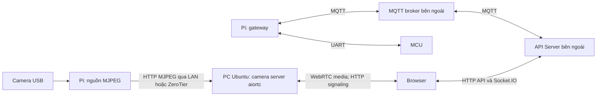

# Deployment — Raspberry Pi 3B và PC Ubuntu

**Đã triển khai source và kiểm thử giả lập:** Pi thu MJPEG từ USB và phục vụ HTTP; PC nhận nguồn, mã hóa VP8 bằng aiortc và phục vụ browser qua WebRTC. Chưa benchmark pipeline mới trên hardware. Gateway và update script vẫn chưa triển khai.



## Vai trò và service

| Máy | Vai trò camera mới | Trạng thái |
| --- | --- | --- |
| Pi 3B | Thu JPEG camera nén sẵn, HTTP MJPEG, giữ frame mới nhất | Đã có source; chưa benchmark hardware |
| PC Ubuntu | HTTP ingest, giải mã JPEG, aiortc/VP8, HTTP signaling và WebRTC | Đã có source; chưa benchmark hardware |
| API Server / MQTT broker ngoài | Telemetry và command | Vai trò riêng, không phải camera server PC |

`deploy/systemd/digital-twin-camera.service` nay chạy role capture trên Pi, dùng `/etc/digital-twin/camera-capture.yaml`. Unit `digital-twin-camera-server.service` chạy role server trên PC, dùng `/etc/digital-twin/camera-server.yaml`. Cả hai giả định repo ở `/opt/digital_twin`; hướng dẫn cài và chuyển đổi nằm tại [camera README](../services/camera/README.md).

Benchmark cũ ghi nhận một worker khoảng 87% một lõi ở 640×480 @ 15 FPS; hai browser gây giật và Pi từng sụt áp. Số đo này thuộc bản encode trên Pi. Chưa có benchmark Pi → PC mới. Việc chuyển encode lên PC không loại bỏ yêu cầu nguồn camera USB ổn định và băng thông ingest.

## UART và camera

- USB-to-UART: đường dẫn dự kiến `/dev/ttyUSB0`; nên kiểm tra tên ổn định như `/dev/serial/by-id/` nếu thiết bị hỗ trợ.
- GPIO UART: TX GPIO14, RX GPIO15 qua `/dev/serial0`; cần cấu hình UART và kiểm tra serial console trên target OS.
- Baudrate ban đầu dự kiến 115200; phải trùng cấu hình firmware.
- Kết nối UART GPIO cần TX/RX nối chéo, chung GND và mức tín hiệu tương thích 3,3 V.
- Camera USB: kiểm tra thiết bị V4L2 thực tế. Camera CSI: xác nhận driver và cách capture tương thích.

Chỉ một process mở UART port tại một thời điểm. Nếu bổ sung flash firmware từ Pi, phải dừng gateway và giải phóng serial trước khi flash tool sử dụng port.

## Cấu hình triển khai

Pi cấu hình camera device/profile trong `capture.yaml`; PC cấu hình HTTP source URL và peer limit trong `server.yaml`. YAML được sao chép sang `/etc/digital-twin/camera-capture.yaml` hoặc `camera-server.yaml` trên máy tương ứng. Unit chọn file qua `CAMERA_CONFIG_FILE`; logging dùng `/etc/digital-twin/logging.yaml`. File `/etc/digital-twin/camera.yaml` cũ không được unit mới đọc. CLI mới yêu cầu `role` và `cameras`; YAML cũ không tương thích. Pi cài FFmpeg và package camera cơ bản; PC cài extra `[server]`. Restart service tương ứng sau khi sửa cấu hình. Credentials, video, log và build artifact không lưu vào Git.

Pi cần kết nối được đến broker bên ngoài qua biến cấu hình `KIT_MQTT_URL`. Web UI tương tác với API Server qua HTTP API và Socket.IO, đồng thời kết nối riêng đến camera service (WebRTC). Broker chỉ chuyển tiếp dữ liệu MQTT giữa Pi Gateway và API Server, không trực tiếp phục vụ Web UI và không tự làm WebRTC signaling server, STUN server, TURN server hoặc media relay nếu chưa được thiết kế rõ cho các vai trò đó.

### Triển khai camera mới

1. Dùng LAN trước: PC kiểm tra kết nối tới Pi bằng IP LAN và SSH để quản trị.
2. Triển khai nguồn V4L2/MJPEG trên Pi và ingest/aiortc trên PC theo [camera README](../services/camera/README.md).
3. PC đọc URL nguồn Pi; browser mở trang PC. Kiểm tra HTTP ingest và WebRTC media riêng.
4. Benchmark một camera 640×480 @ 15 FPS, sau đó tăng FPS, người xem hoặc camera.
5. Đổi URL nguồn sang IP ZeroTier khi cần khác mạng, đo lại latency và bandwidth.

Endpoint mẫu đã triển khai: Pi `http://10.147.19.87:5001/cameras/camera1/video_feed`; PC `http://10.147.19.29:5000/` và `POST /offer`. Browser trên PC dùng `http://localhost:5000/`. Cần cài dependency mới và cập nhật unit trước khi chạy.

### ZeroTier và SSH

PC đã có IP ZeroTier `10.147.19.29`; Pi `10.147.19.87`, cả hai báo `OK`. ZeroTier tạo mạng ảo, không cấp camera server; PC của người phát triển đảm nhiệm vai trò server. LAN không bắt buộc ZeroTier. IP phải cấu hình được và không hard-code vào source.

```bash
# Chạy trên PC để kiểm tra đường mạng ZeroTier và quản trị Pi
ping -c 4 10.147.19.87
ssh thang@10.147.19.87
```

SSH không vận chuyển video trong thiết kế. Service phải tiếp tục chạy khi ngắt SSH. PC cần bật và chạy server để browser nhận hình. HTTP mở được không bảo đảm ICE/UDP media đã hoạt động; demo LAN không STUN/TURN, đường ZeroTier phải kiểm tra riêng.

### Thông tin broker cần xác nhận

Các hostname được cung cấp để xác định dịch vụ:

- `mqtt.mysignage.vn`
- `thachthanh.vov.link`
- `remote.mysignage.vn`
- `ybimqtt.mysignage.vn`

Chưa chọn hostname làm endpoint chính, chưa xác định vai trò của từng hostname và chưa xác nhận loại broker đang sử dụng. Danh sách này không phải cấu hình kết nối đã kiểm chứng hoặc thông tin tài khoản.

Trước khi tích hợp, cần xác nhận:

- Endpoint `KIT_MQTT_URL` (hostname, port, TCP plain hay TLS) dành cho Gateway trên Pi.
- Username/password nếu broker yêu cầu (bảo vệ mạng theo NFR-SEC-003; MVP không cấp credential riêng từng kit).
- Quyền publish topic `lab/kit/{kit_code}/telemetry`, `lab/kit/{kit_code}/heartbeat` và subscribe topic `lab/kit/{kit_code}/cmd/+`.
- Connection limit và timeout cấu hình trên broker.

Không mặc định server dùng port 1883 hoặc 8883. Credentials thực tế không lưu trong Git.

## Software update

Update script đặt tại `scripts/update.sh`, chưa cần service chạy liên tục. Thiết kế ban đầu là lấy phiên bản từ Git rồi restart ứng dụng liên quan qua systemd.

Trước khi triển khai cần chốt branch hoặc version, quyền cập nhật, xử lý working tree có thay đổi, dependency, health check sau restart và rollback khi update lỗi. Branch `main` và thao tác `git pull` là phương án ban đầu, chưa phải quy trình vận hành hoàn chỉnh.

Flash firmware ESP32 từ xa và lịch cập nhật bằng systemd timer là tính năng dự kiến, chưa triển khai.
